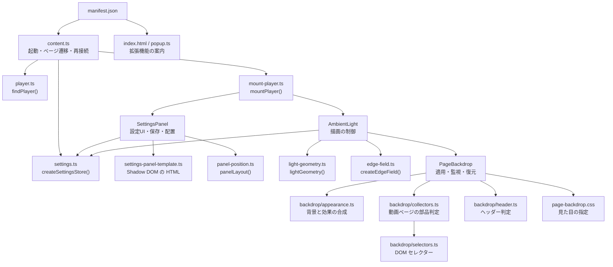
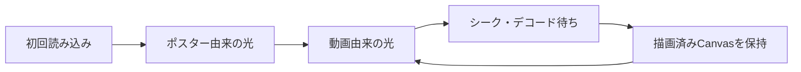
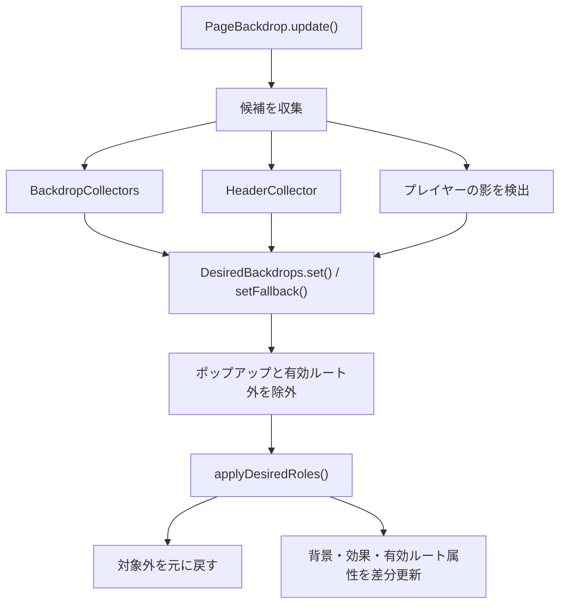

このコードベースは、ニコニコ動画の映像から周縁部の色を取り出し、プレイヤーの背後にアンビエントライトを表示するブラウザ拡張機能です。

設計上は、光の描画、サイト背景の調整、設定UI、起動・終了管理を分けています。状態や後片付けを持つ処理にはクラスを使い、検出・正規化などの処理には関数を使っています。

## 1. アーキテクチャ



実行基盤は、Manifest V3、TypeScript、ブラウザ標準APIです。UIフレームワークやバックエンド、Service Workerはありません。

クラス間は継承せず、インスタンスを組み合わせています。

| モジュール             | 責務                   | 主に保持する状態              |
| ----------------- | -------------------- | --------------------- |
| `content.ts`      | 起動・ページ遷移・プレイヤー交換への対応 | 現在接続しているプレイヤー         |
| `player.ts`       | プレイヤー検出              | なし                    |
| `mount-player.ts` | UIと描画機能の組み立て         | 作成したインスタンスへの参照        |
| `settings.ts`     | 設定の正規化・保存            | 現在の設定                 |
| `SettingsPanel`   | 設定UIと操作              | DOM、保存タイマー、位置更新予約     |
| `AmbientLight`    | 描画条件・更新・配置           | Canvas、描画履歴、動画の状態     |
| `light-geometry.ts` | 光の距離・マスク・CSS寸法を計算 | なし |
| `edge-field.ts`   | 周縁色から光の画像を生成         | サンプリングCanvas、出力画素バッファ |
| `backdrop/*` | 背景と効果の合成・DOM候補の判定 | 判定ごとの一時データ |
| `settings-panel-template.ts` / `panel-position.ts` | 設定UIのHTMLと配置計算 | なし |
| `PageBackdrop`    | サイト要素へのスタイル適用・復元     | 元の属性、影の情報、DOM監視状態     |

`SettingsPanel`、`AmbientLight`、`PageBackdrop` はコンストラクターで初期化し、`destroy()` で後片付けします。`BackdropCollectors` と `HeaderCollector` はDOMの候補判定を担当し、`DesiredBackdrops` は候補ごとの背景と効果を合成します。内部の状態や補助メソッドには `private`、再代入しない参照には `readonly` を使います。

## 2. 起動とページ遷移：`content.ts`

`manifest.json` は、`https://www.nicovideo.jp/*` に対して `document_start` で`content.js` を実行します。

視聴ページ以外でも起動するのは、サイト内遷移で視聴ページに入る場合に対応するためです。ライトを実際に開始するかどうかは、`content.ts` が判断します。

| 関数                    | 実装と役割                                    |
| --------------------- | ---------------------------------------- |
| `start()`             | 対象ホストを確認し、設定ストア・監視・イベントを初期化する入口          |
| `reconcile()`         | URLとDOMの現在状態を確認し、機能を維持・破棄・再作成する          |
| `scheduleReconcile()` | 次の描画フレームに `reconcile()` を予約し、連続した通知をまとめる |
| `observePage()`       | document全体へ `MutationObserver` を設定する     |
| `onSettingsReady()`   | 設定読み込みの終了を通知し、最初の接続確認を行う                 |

`reconcile()` は次の順序で処理します。

1. 設定読み込みが終わっていなければ処理を待つ。
2. URLが `/watch/<動画ID>` 以外なら、接続中の機能を破棄する。
3. 接続中の動画・設定ボタンがDOMに残り、親子関係も正常なら維持する。
4. 接続が壊れていれば、既存機能を破棄する。
5. `findPlayer()` で検出し直し、見つかれば `mountPlayer()` を呼ぶ。

プレイヤーDOMがサイト側で作り直された場合も、この処理で再接続します。

再確認のきっかけには、以下があります。

- DOMの追加・削除
- `class`、`aria-label`、`title` の変更
- `loadedmetadata`、`loadeddata`
- ウィンドウのリサイズ
- 1秒間隔のポーリング

DOM変更などの通知は、`scheduleReconcile()` が `requestAnimationFrame` にまとめます。同じフレームに何度も通知されても、再確認は1回に抑えます。

`pagehide` では監視を止め、接続中の機能を破棄します。`BFCache` から戻った場合は、`pageshow` で監視を再開します。

## 3. プレイヤー検出：`player.ts`

`findPlayer()` は、動画要素と全画面ボタンを手掛かりにプレイヤーを探します。

処理は以下です。

1. ページ内の `video` を列挙する。
2. 表示サイズが幅200px・高さ100pxを超えるものを候補にする。
3. `clientWidth × clientHeight` が大きい順に調べる。
4. 各動画から最大10階層、祖先をさかのぼる。
5. 全画面ボタンを含む最初の祖先をプレイヤーとする。

全画面ボタンは、日本語・英語の `aria-label`、`title`、既知の属性やクラスで検出します。

返り値は次の形です。

```
{
  video,    // 映像の取得元と、光の位置・サイズの基準
  player,   // 動画と操作部を含む領域
  controls, // 拡張機能の設定ボタンを追加する操作列
}
```

検出できなければ `undefined` を返します。

`PlayerTarget` は、`findPlayer()` の返り値から `undefined` を除いた型です。後続のコードでは「プレイヤーが見つかっている」ことを型で表しています。

## 4. 組み立て：`mount-player.ts`

`mountPlayer(target, store)` は、各機能を接続する関数です。

```ts
const panel = new SettingsPanel(store, target.player);
target.controls.append(panel.host);

const light = new AmbientLight(
  target,
  store.get,
  panel.setStatus,
);
```

`AmbientLight` に渡すのは設定ストア全体ではなく、設定を読む `store.get` です。同様に、エラー表示にはパネル全体ではなく `panel.setStatus` を渡します。

これにより、描画クラスは保存方法や設定パネルのDOM構造を知る必要がありません。

`mountPlayer()` は、プレイヤー参照と次の操作を返します。

| 公開項目        | 用途                                    |
| ----------- | ------------------------------------- |
| `host`      | 設定ボタンがまだ接続されているかの確認                   |
| `sync`      | 外部から設定が変わった際のUI更新                     |
| `destroy()` | light.destroy() と panel.destroy() を呼ぶ |

このオブジェクトを `content.ts` が保持し、ページ遷移やプレイヤー交換に合わせて破棄します。

## 5. 設定管理：`settings.ts`

設定は次の型です。

```ts
type Settings = {
  enabled: boolean;
  brightness: number;
  spread: number;
};
```

| 設定           |  既定値 |      範囲 |
| ------------ | ---: | ------: |
| `enabled`    | true | boolean |
| `brightness` |   65 |   0〜100 |
| `spread`     |  200 |   0〜400 |

`NUMERIC_SETTINGS` は明るさ・広がりの最小値、最大値、刻み幅、既定値を共有します。`settings-panel-template.ts` のスライダーと数値入力もこの定義を参照します。

`normalizeSettings(input)` は、読み込み値やUI入力を正規化します。内部の `normalizeNumber()` が有限値の判定・範囲への収め込み・既定値の適用を担います。

- 型が合わない値は既定値にする。
- `NaN` や無限大は受け付けない。
- 数値を許容範囲内に収める。
- 欠落した設定を既定値で補う。

`createSettingsStore()` は現在値をクロージャ内に保持し、以下を返します。

| メソッド         | 処理                          |
| ------------ | --------------------------- |
| `get()`      | 現在の設定を返す                    |
| `set(value)` | 正規化してメモリ上の設定を更新する           |
| `load()`     | chrome.storage.local から読み込む |
| `save()`     | 現在値をストレージへ保存する              |

保存キーは `nicoAmbientSettings` です。

UI操作では、まず `set()` でメモリ上の値を変えます。描画側は毎フレーム `get()` を呼ぶため、保存完了を待たずに反映されます。

別のタブなどから保存値が変わった場合は、`content.ts` の `chrome.storage.onChanged` が設定ストアとUIを更新します。

## 6. 設定UI：`SettingsPanel`

`settings-panel.ts` の `SettingsPanel` は、設定ボタン、入力欄、パネル配置、保存予約を管理します。

コンストラクターでは、`span` のホストとShadow DOMを作成し、`settings-panel-template.ts` が組み立てたHTMLと `settings.css` を挿入します。パネルには `popover="auto"` を使っています。

Shadow DOMによって、設定UIのCSSとサイト側のCSSが干渉しにくくなっています。

| メソッド                         | 実装と使われ方                         |
| ---------------------------- | ------------------------------- |
| `constructor(store, player)` | DOMを作成し、入力・開閉・キーボードイベントを登録する    |
| `handleInput(event)`         | 数値欄と通常の入力欄を読み、ストアとUIを更新する |
| `scheduleSave()` | 既存のタイマーを取り消し、150ms後の保存を予約する |
| `close()` | ポップアップを閉じ、設定ボタンにフォーカスを戻す |
| `required(selector)`         | Shadow DOM内の必須要素を取得。なければ例外にする   |
| `sync()`                     | ストアの値をチェックボックス・スライダー・数値欄へ反映する   |
| `save()`                     | 設定を保存し、失敗時はパネル内にメッセージを出す        |
| `updatePosition()`           | `panelLayout()` の結果をパネルに反映する |
| `trackPosition()`            | 開いている間、毎フレーム配置を更新する             |
| `setStatus(message)`         | 描画側などから受け取ったメッセージを表示する          |
| `destroy()`                  | 位置追従を停止し、保存予約を処理してホストを削除する      |

入力イベントは、設定を即時更新して `sync()` を呼び、その後150msの保存タイマーを設定します。入力が続くとタイマーを予約し直すため、スライダー操作中に保存が大量発生するのを抑えています。

数値入力では、入力途中の空欄を無視し、フォーカス中の値を `sync()` で上書きしません。フォーカスが外れると正規化済みの値を表示し、Enterでも入力を確定できます。

`panel-position.ts` の `panelLayout(rect, innerWidth, innerHeight)` は、最大寸法と、実測したパネル寸法から位置を求める `position(box)` を返します。`updatePosition()` がその値をDOMに反映します。左右の空きが大きい側へパネルを配置します。両側とも狭い場合はプレイヤーに重ねて表示し、画面端から12px内側に収めます。全画面でも操作可能な幅を確保するための処理です。

`handleInput`、`sync`、`save`、`trackPosition`、`setStatus` はアロー関数のフィールドです。コールバックとして渡しても、`this` がその `SettingsPanel` インスタンスを参照します。

## 7. 描画制御：`AmbientLight`

`ambient-light.ts` の `AmbientLight` は、描画する画像、表示条件、位置、更新タイミングを管理します。

コンストラクターでは、次を作成します。

- 固定配置のライト用 div
- `light-geometry.ts` の `FIELD_SIZE` で定義した内部解像度96×64のCanvas
- `PageBackdrop` インスタンス
- `createEdgeField()` が返す描画関数
- スクロール・リサイズへのイベント登録

ライトのレイヤーには、次の性質があります。

```
position: fixed;
inset: 0;
pointer-events: none;
z-index: -1;
overflow: hidden;
```

Canvasは小さい内部解像度のまま、CSSで大きく表示します。

| メソッド                                          | 実装と使われ方                                         |
| --------------------------------------------- | ----------------------------------------------- |
| `constructor(target, getSettings, setStatus)` | 描画用DOM、依存機能、イベント、描画ループを初期化する                    |
| `update(checkBackdrop = false)`               | 描画元・表示条件・配置を判断し、必要なら画像を更新する                     |
| `renderFrame()`                               | `update()` を呼び、次の `requestAnimationFrame` を予約する |
| `onViewportChange()`                          | `update(true)` を呼び、背景の再走査も要求する                  |
| `destroy()`                                   | 描画予約とイベントを解除し、ライトと背景処理を破棄する                     |

`update()` は、以下の順序で処理します。

1. 動画の表示矩形を取得する。
   光の基準は `player` の外枠ではなく、`video.getBoundingClientRect()` です。操作部などの余白を含めず、映像の縁に合わせます。
2. ライトの配置先を決める。
   通常は `document.body`、動画を含むFullscreen要素があればその要素へ移します。
3. ポスターと動画ソースの変更を確認する。
   ポスターURLが変われば画像を作り直します。`currentSrc` が変われば描画失敗状態などをリセットします。
4. 描画元を決める。
   シーク中でなく、動画フレームが利用可能なら `video` を使います。初回読み込み時は、読み込み済みのポスターを使えます。
5. 表示できるかを判定する。
   無効、広がり0、非表示タブ、Picture-in-Picture、サイズ0、描画失敗時にはライトを隠し、背景変更も解除します。
6. `lightGeometry(rect, spread, brightness)` で領域・マスク・Canvas CSS・描画座標を計算し、ライトへ反映する。
7. 必要な場合だけ画素を描き直す。
   入力画像、再生時刻、動画サイズ、広がりが変わっていなければ画素生成を省略します。
8. 描画後に背景処理を有効化する。
   光が準備できる前に、サイトの背景だけが透明になるのを防ぎます。

寸法は `light-geometry.ts` の `lightGeometry()` が以下の式で決めています。返り値の `layerStyle` と `canvasStyle` を各要素へ適用し、`field` を `drawField()` に渡します。`MAX_BLUR=60`、`BLUR_RATIO=0.08`、`BLUR_PADDING=3` は同じファイルにまとめています。

```
短辺 = min(動画幅, 動画高さ)

到達距離 = 短辺 × spread / 100
ぼかし量 = min(60px, 短辺 × 0.08)
余白 = ぼかし量 × 3

Canvas表示幅 = 動画幅 + 2 × (到達距離 + 余白)
Canvas表示高 = 動画高 + 2 × (到達距離 + 余白)
```

`brightness` はレイヤーの `opacity` に反映します。横方向と縦方向のグラデーションマスクを `intersect` で重ね、動画から離れるほど光が薄くなるようにしています。

シーク中は、`hasRenderedVideo` が重要です。



一度動画を描画した後は、動画フレームが一時的に使えなくてもポスターへ戻りません。描画済みCanvasを保持し、シーク先のフレームが使えるようになったら更新します。

**この処理は光の保持であり、時間方向のクロスフェードや色補間は行っていません。**

## 8. 周縁色の生成：createEdgeField()

`edge-field.ts` の `createEdgeField(context)` は、入力画像から光の画像を作る関数を返します。

初期化時に、96×64のサンプリングCanvasと、再利用する出力 `ImageData` を確保します。

返される関数は、`AmbientLight` から次のように使われます。

```ts
drawField(input, {
  left,
  top,
  width,
  height,
  fieldWidth,
  fieldHeight,
});
```

`input` は `video` または `poster` です。`geometry` は、光全体の表示領域に対して動画がどこにあるかを表します。

描画処理は次のとおりです。

1. 入力画像をサンプリングCanvasへ縮小描画する。
2. `getImageData()` で画素を読む。
3. 出力の各画素を動画基準の座標へ変換する。
4. 対応する映像の辺または角の色を選ぶ。
5. RGBをコピーし、アルファ値を255にする。
6. `putImageData()` で出力Canvasへ反映する。

動画の外側では座標を0〜1に収め、辺や角の色を延長します。動画の内側に相当する領域も、最も近い辺の色で埋めます。

内部も不透明に埋めるのは、透明な穴をぼかした際にページ背景の白・黒が混ざり、プレイヤー周囲に線が現れるのを避けるためです。動画自身が前面にあるため、動画内部に生成した光は隠れます。

## 9. サイト背景の制御：`PageBackdrop`

`page-backdrop.ts` の `PageBackdrop` は監視、状態保存、適用、復元を担当します。判定と見た目は以下のファイルへ分けています。

| ファイル | 担当 |
| --- | --- |
| `backdrop/appearance.ts` | 要素ごとの背景と効果の合成、属性の差分更新、元状態の保存・復元 |
| `backdrop/collectors.ts` | surface、タグ編集中のオーバーレイ、コメント投稿欄、操作ボタンの候補収集 |
| `backdrop/header.ts` | 共通ヘッダー、検索欄、期間限定バナーの判定 |
| `backdrop/selectors.ts` | サイトDOMのセレクターとポップアップ除外条件 |
| `styles/page-backdrop.css` | 背景、ぼかし、文字色、影、境界線のCSS |

DOMには互いに独立した3種類の属性を付けます。

| 属性 | 値・意味 |
| --- | --- |
| `data-nico-ambient-active` | 現在のライトの有効ルート。通常は `body`、全画面時は全画面要素 |
| `data-nico-ambient-backdrop` | `clear`（透明化）、`surface`（48pxぼかし）、`soft`（6pxぼかし） |
| `data-nico-ambient-effects` | 空白区切りの効果。疑似要素の透明化、影やfilterの除去、区切り線やオーバーレイの調整など |

従来の `root`、`page-shell`、`header-surface`、`surface-group`、`surface-divider` などは候補収集時の内部名です。`DesiredBackdrops.set()` が内部名を上記の背景・効果へ変換します。例えば `header-surface` は `clear` と `clear-pseudos`、`no-box-shadow`、`header-links` の組み合わせになります。`surface-group` は `surface` に加えて疑似要素の角丸を親へコピーします。プレイヤーの影除去は背景と共存できます。

同じ要素に複数の候補がある場合、背景は収集順による明示的な上書き、効果は集合への追加です。`setFallback()` は未分類の場合だけ背景を補い、ヘッダーや検索欄が既存の `surface` を消さないようにします。ポップアップ本体とその内部は除外し、通常の `data-part="trigger"` ボタンには明示的な適用を許可します。



| 関数・メソッド | 実装と使用箇所 |
| --- | --- |
| `PageBackdrop.constructor(player, video)` | 収集器、DOM監視、CSS用style要素を作る |
| `paintsBackground(element, pseudo?)` | 計算済み背景色・背景画像を確認する |
| `hasPaintedBackground(element)` | 要素と疑似要素を調べ、拡張機能が既に透明化した背景も履歴から認識する |
| `addPlayerShadowResets(desired)` | 動画と祖先の影を記録し、再走査中も除去効果を維持する |
| `collectPlayerAndSurfaceRoles(root, desired)` | 有効ルート、プレイヤー祖先、ページ部品を収集する |
| `BackdropCollectors.collectSurfaceRoles(desired, root)` | ルート内のsurfaceを収集する。祖先の探索もルート内で止める |
| `BackdropCollectors.collectTagEditOverlayRoles(desired)` | タグ編集のオーバーレイを前面に出す |
| `BackdropCollectors.collectCommentComposerRoles(desired)` | 投稿欄の共通親を探し、親をぼかして子や非ログイン時の覆いを透明化する |
| `BackdropCollectors.collectControlRoles(desired)` | 通常の操作ボタンに背景を指定し、ポップアップ内を除外する |
| `HeaderCollector.collectHeaderRoles(desired)` | ヘッダー、検索欄、バナーを判定し、補完と明示上書きを使い分ける |
| `HeaderCollector.isSticky(header)` | 位置と計算済みスタイルで追従ヘッダーを判定する |
| `applyDesiredRoles(desired)` | 属性の差分更新、対象外の復元、角丸のコピーと復元を行う |
| `restore()` / `destroy()` | 元の属性・角丸へ戻し、監視と追加CSSを撤去する |
| `DesiredBackdrops.set()` / `setFallback()` | 内部ロールを背景と効果に合成する。後者は未分類の場合のみ |
| `snapshot()` / `restoreElement()` | 元の3属性と四隅の角丸値・優先度を保存・復元する |
| `restoreRadius()` / `writeAttribute()` | 角丸の個別復元と属性の差分書き込みを行う |

`original` は元の3属性と角丸を保持し、`originalPlayerShadows` は元から影があったかを保持します。背景検出によって透明化した履歴も `original` に保持し、見た目の `clear` とは区別します。全画面に入ると有効ルート外の属性を復元し、通常表示へ戻ると再分類します。

`MutationObserver` はDOM変更時に `dirty` を立てます。`update()` は `dirty`、ルート、有効状態、`force` に応じて再走査します。拡張機能自身の属性や毎フレーム変わるCanvasのstyleは監視対象に含めません。

`page-backdrop.css` のぼかし・彩度・文字色・輪郭色などは `--nico-*` 変数にまとめています。`surface` の `backdrop-filter` は背後の光をぼかし、`AmbientLight` のCanvas `filter` は光自体をぼかします。

## 10. コールバックと後片付け

Class化で注意しているのは、コールバックに渡すメソッドの `this` です。

例えば通常のメソッドをそのまま渡すと、呼び出され方によって this が失われます。現在は、コールバックに使うものをアロー関数のフィールドにしています。

```ts
private readonly onViewportChange = () => this.update(true);

private renderFrame = () => {
  this.update();
  this.frame = window.requestAnimationFrame(this.renderFrame);
};
```
イベントの登録と解除には同じ関数参照を使います。

```ts
window.addEventListener('resize', this.onViewportChange);
window.removeEventListener('resize', this.onViewportChange);
```

破棄の流れは、作成した側が所有物を順に片付ける形です。

```
content.ts
  → mountPlayer().destroy()
      → AmbientLight.destroy()
          → PageBackdrop.destroy()
      → SettingsPanel.destroy()
```

この構造により、ページ遷移の処理がCanvas・CSS・設定UIの内部まで直接操作する必要がありません。

## 11. ビルド・ポップアップ・テスト

`vite.config.ts` は、`src/index.html` と `src/scripts/content.ts` を入口に、`dist/` へ出力します。`public/manifest.json` もコピーし、ソースマップを生成します。

`popup.ts` は、ツールバーから開く案内画面の処理です。拡張機能として実行中か、通常ブラウザでプレビュー中かを判定して表示します。設定変更は `SettingsPanel` が担当します。

テストは以下の責務に分かれています。

| ファイル                     | 主な確認対象                      |
| ------------------------ | --------------------------- |
| `tests/node/build.test.mjs`         | Manifest の参照先とコンテンツスクリプトの形式 |
| `tests/node/edge-field.test.mjs`    | 中央色の混入防止、辺の方向、不透明性          |
| `tests/node/startup.test.mjs`       | 遅れて追加されるプレイヤーの検出            |
| `tests/node/loading-light.test.mjs` | ポスターから動画への切り替え、シーク中の光の保持    |
| `tests/node/page-backdrop.test.mjs` | ロール適用・除外・復元・影の維持            |
| `tests/node/lifecycle.test.mjs`     | 起動、設定、ページ遷移、配置、破棄           |
| `tests/browser/settings.spec.ts` | 設定ボタン、変更と保存 |
| `tests/browser/lifecycle.spec.ts` | ページ内遷移、再接続、対象外ホスト |
| `tests/browser/rendering.spec.ts` | 映像周縁の色、不透明性、マスクと画面合成 |
| `tests/browser/backdrop.spec.ts` | 背景履歴、全画面ルートでの祖先判定・復元 |
| `tests/helpers/bundle.mjs` | Viteでソースをテスト用IIFEに束ね、必要な依存を差し替える |

### Playwrightによるブラウザーテスト

`playwright.config.ts` は `tests/browser/*.spec.ts` を実行します。各プロジェクトで同じ8件のテストを実行し、全5プロジェクトで40件になります。

| プロジェクト | 使用するブラウザー | サポート状況 |
| --- | --- | --- |
| `chromium` | Playwright Chromiumまたは指定した実行ファイル | 開発時の基準環境 |
| `chrome` | Google Chrome Stable | デスクトップ版の配布対象 |
| `msedge` | Microsoft Edge Stable | デスクトップ版の配布対象 |
| `firefox` | Playwright Firefox | 正式サポート対象外・互換性検証中 |
| `webkit` | Playwright WebKit | Safari系の描画確認。Safari本体は正式サポート対象外 |

`pnpm test:browser` はChromiumだけ、`pnpm test:browser:all` は5プロジェクトすべてを実行します。通常はPlaywrightが管理するChromiumを使い、`PLAYWRIGHT_CHROMIUM_EXECUTABLE_PATH` はChromiumプロジェクトだけに適用されます。

全プロジェクトの実行前には `pnpm test:browser:install` でブラウザーとLinuxの実行依存を導入します。Chrome・EdgeはOSの標準配置先にインストールされるため、既存のインストールが置き換わる場合があります。

初回はChromiumを導入し、その後ブラウザテストを実行します。`test:browser` は型チェックとViteビルドを行ってからPlaywrightを起動するため、`dist/content.js` は最新の状態になります。

```bash
pnpm exec playwright install chromium
pnpm test:browser
```

`browser/helpers/player.ts` はニコニコ動画の視聴ページをテスト用HTMLに差し替え、Canvasから作った動画ストリームを再生して `dist/content.js` を読み込みます。設定ボタンの追加と保存、ページ内遷移時の破棄・再接続、対象外ホストでの非起動を確認します。ライト用Canvasの画素と実際の画面合成も調べ、明るい中心を持つ暗い映像で周縁の光が白くならないことをライト・ダーク両背景で確認します。動画を囲む余白ではなく映像の矩形にマスクが合うことも確認します。Canvasの内容を変えた後は `requestFrame()` でフレームを送り、動画へ反映されたことを待ってから光の画素を検査します。

`tests/browser/backdrop.spec.ts` は `PageBackdrop` をテスト用IIFEとして各ブラウザープロジェクトへ読み込みます。背景属性が `surface` に変わっても疑似要素の透明化と背景検出の履歴が安定すること、全画面ルート外のsurfaceが内側の分類に影響しないこと、通常表示に戻した後と破棄時に属性が復元されることを確認します。

テストには模擬視聴ページ、Canvasから生成した動画、模擬した拡張機能ストレージを使います。Manifestからの実際の読み込みや権限、ニコニコ動画の実ページでの動作は検証対象外です。WebKitはSafari本体ではないため、Firefox・Safari版拡張機能を正式にサポートするには、それぞれの実ブラウザーで追加の確認が必要です。

設計を変更するとき、サイトのDOM変更への対応は主に `player.ts` と `backdrop/collectors.ts`・`header.ts`・`selectors.ts`、背景属性の合成は `backdrop/appearance.ts`、光の距離と配置は `light-geometry.ts`、光の色は `edge-field.ts`、描画タイミングとシーク処理は `AmbientLight`、設定操作は `SettingsPanel` が変更箇所になります。
